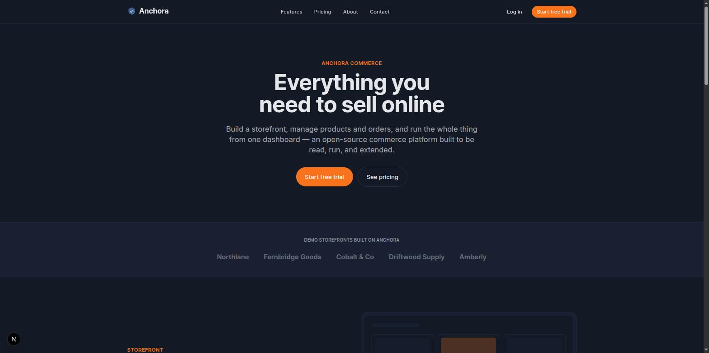
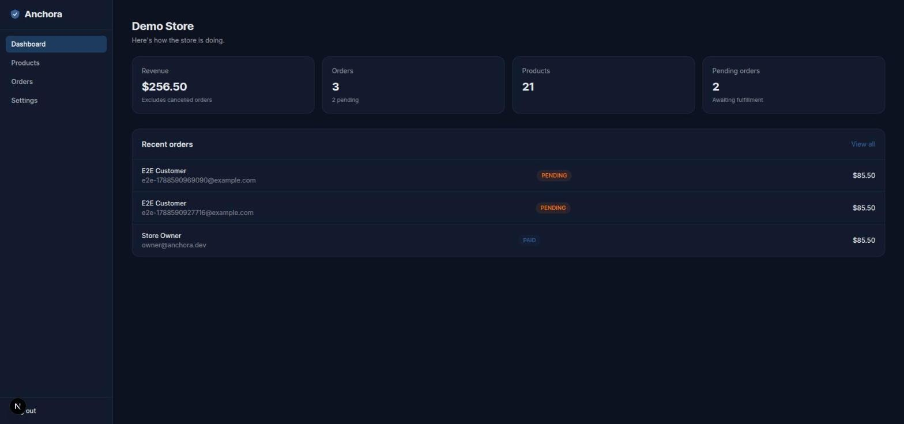

# Anchora Commerce

A full-stack commerce platform — marketing site, storefront with cart and checkout, and a role-gated
admin dashboard — built with Next.js 15 App Router, TypeScript, Prisma/Postgres, and Docker.

This is a portfolio project, not a live business. It exists to demonstrate a complete, production-shaped
system: real auth, a real database, a real REST API underneath the UI, tests, and a working Docker build —
not a static mockup. It is not affiliated with Shopify or any other company.




## Stack

Next.js 15 (App Router, Turbopack) · TypeScript (strict) · Tailwind CSS 4 · Prisma 7 + PostgreSQL
(via `@prisma/adapter-pg`, no native query-engine binary) · zod · bcryptjs + JWT (`jose`) auth with rotating
refresh tokens · Vitest (unit) + Playwright (E2E) · Docker (multi-stage) · GitHub Actions.

## Features

- **Marketing site** — home, pricing (3 tiers + comparison table), features, about, contact.
- **Storefront** — product grid with search/sort/pagination, product detail, a cart backed by Postgres
  (not just a cookie), and checkout that writes a real `Order` in a transaction (validates stock, snapshots
  prices, decrements inventory, clears the cart).
- **Admin dashboard** — role-gated (`OWNER`/`ADMIN` only): KPI cards from real aggregate queries, product
  CRUD, and an order list with status transitions (`PENDING → PAID → FULFILLED`/`CANCELLED`).
- **Auth** — bcrypt-hashed passwords, JWT access tokens (15m) + rotating refresh tokens (7d, httpOnly
  cookies), rate-limited auth endpoints.
- **API** — versioned REST under `/api/v1`, a consistent `{ success, data, message }` /
  `{ success, error, message, details }` envelope, zod validation at every boundary, Controller → Service →
  Repository layering (`lib/services/*`).

## Getting started

```bash
npm install
cp .env.example .env        # fill in JWT_SECRET / JWT_REFRESH_SECRET (see below)
docker compose up -d db
npx prisma migrate deploy
npx prisma db seed
npm run dev
```

Generate secrets for `.env`:

```bash
openssl rand -base64 48   # run twice, once each for JWT_SECRET and JWT_REFRESH_SECRET
```

Open http://localhost:3000. Demo accounts (seeded, password `password123` for both):

| Role     | Email                | Notes                              |
| -------- | --------------------- | ----------------------------------- |
| OWNER    | `owner@anchora.dev`   | Full access to `/admin`             |
| CUSTOMER | `customer@anchora.dev`| Storefront only                     |

The seeded storefront lives at `/store/demo-store` with 20 demo products.

## Environment variables

| Variable               | Required | Description                                              |
| ----------------------- | -------- | ---------------------------------------------------------- |
| `DATABASE_URL`          | yes      | Postgres connection string                                 |
| `JWT_SECRET`            | yes      | 32+ char secret for access tokens                          |
| `JWT_EXPIRES_IN`        | no       | Access token lifetime (default `15m`)                      |
| `JWT_REFRESH_SECRET`    | yes      | 32+ char secret for refresh tokens                         |
| `JWT_REFRESH_EXPIRES_IN`| no       | Refresh token lifetime (default `7d`)                      |
| `CORS_ORIGIN`           | no       | Allowed origin (default `http://localhost:3000`)           |

All required variables are validated at startup (`lib/env.ts`) — the app refuses to boot with a clear
error if any are missing.

## Commands

| Command              | Description                                    |
| ---------------------- | ------------------------------------------------- |
| `npm run dev`         | Start the dev server (Turbopack)                |
| `npm run build`       | Production build                                |
| `npm run start`       | Run the production build                        |
| `npm run lint`        | ESLint                                          |
| `npm run typecheck`   | `tsc --noEmit`                                  |
| `npm run test`        | Vitest unit tests                               |
| `npm run test:e2e`    | Playwright E2E suite (needs the app running)    |
| `npm run format`      | Prettier                                        |

## Running with Docker

```bash
docker compose up -d db
npx prisma migrate deploy && npx prisma db seed   # once, from the host, against the exposed db port
docker compose up -d app
```

The app container's healthcheck hits `/api/v1/health`. Migrations are run from the host rather than baked
into the container's entrypoint, since the production image doesn't ship the Prisma CLI (only the
generated client, which the standalone build traces in).

## Architecture notes

- **Route groups** separate concerns at the layout level: `(marketing)` and `(shop)` share a public
  header/footer; `(admin)` has its own sidebar layout and redirects non-staff to `/login`; `(auth)` is a
  minimal centered layout.
- **Driver adapters** (`@prisma/adapter-pg`) mean Prisma has no native query-engine binary to worry about
  across platforms/Docker — it's pure JS + the `pg` driver.
- **JWT verification is split** between `lib/auth.ts` (Node runtime — bcrypt, `node:crypto`, Prisma) and
  `lib/jwt-edge.ts` (edge-safe, used by `proxy.ts`/middleware) so the edge runtime bundle never pulls in
  Node-only APIs.
- **Soft deletes** on `Product`/`Store` (`deletedAt`), price snapshots on `OrderItem` so historical orders
  don't change if a product's price changes later.

## Testing

Unit tests (`tests/unit/`) cover pure business logic with no DB dependency: price/slug formatting, every
zod schema, and password hashing. The E2E suite (`tests/e2e/`) drives a real browser against a real
Postgres-backed instance: register → add to cart → checkout → order appears in the admin dashboard, and
admin product create/delete.

## Scope

This is a demo, not a payment processor: checkout is explicitly labeled a mock and no real payment is
collected, though placing an order does write a real `Order` row and decrement real inventory. Multi-store
admin access is a simplification (an `OWNER` manages the store they own; any other staff manages the first
store in the system) — a real multi-tenant version would join staff to stores explicitly.

## License

MIT
